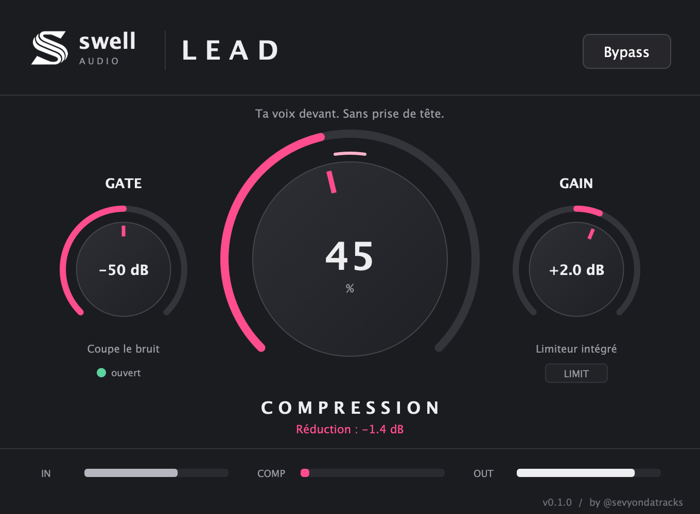

# Swell Lead — 0.1.0 prototype



*Capture rendue par le vrai code de l'interface (Tools/LeadTool), avec une voix qui passe.*

Compression voix en un bouton, pensée pour les beatmakers et les rappeurs.
Fabricant : Swell-audio. Logo officiel inclus. Couleur : rose `#ff4d8d`.

## Les réglages

| Bouton | Ce qu'il fait |
|---|---|
| **Compression** (0–100 %) | Plus on monte, plus la voix est tenue et passe devant. Le volume remonte tout seul (et un peu plus à mesure qu'on monte). Seuil, ratio et remontée suivent le bouton. Double-clic : 40 %. |
| **Gate** (Off à -20 dB) | Coupe le bruit entre les phrases (-40 dB d'atténuation, ouverture rapide, fermeture douce). Tout à gauche = éteint. Voyant vert = la voix passe. |
| **Gain** (-12 à +12 dB) | Volume de sortie, suivi d'un limiteur avec anticipation 1,5 ms, plafond -0,5 dBFS. Voyant LIMIT quand il travaille. |
| **Bypass** | Comparaison avec latence compensée. |

Chaîne : Gate → Compression (+ remontée auto) → Gain → Limiteur. Détection liée en stéréo.
Latence : 1,5 ms (déclarée au DAW). Paramètres sauvegardés et automatisables. Mono et stéréo.
Licence Swell commune (slug boutique : `swell-lead`) : silence tant que le plugin n'est pas activé.

## Compilation (Mac)

JUCE 8.0.6 et Monocypher téléchargés par CMake.

```sh
./build-mac.sh
```

Sorties : `build/SwellLead_artefacts/Release/` (VST3, AU, Standalone, Intel + Apple Silicon).
Tests DSP : neutre à 0 %, plafond du limiteur respecté, gate actif, sortie finie, à 44,1/48/96/192 kHz.

Outil hors ligne (captures et rendus audio avec le vrai moteur) :

```sh
cmake -S . -B build -DLEAD_BUILD_TOOLS=ON && cmake --build build --target LeadTool
LeadTool snapshot docs/swell-lead.png Demo/01-voix-avant.wav 45 -50 2
LeadTool render Demo/01-voix-avant.wav Demo/02-voix-apres-lead-60.wav 60 -50 0
```

## État vérifié (12/11/2026)

- VST3, AU et Standalone compilés (arm64 + x86_64), signature ad-hoc.
- `auval -v aufx Slea Swel` : AU VALIDATION SUCCEEDED.
- Installé sur le Mac : `~/Library/Audio/Plug-Ins/Components`, `~/Library/Audio/Plug-Ins/VST3`, `/Applications/Swell Lead.app`.
- Standalone lancé : s'ouvre sur l'écran d'activation (normal tant que le produit n'existe pas sur le site).
- Pas encore testé à l'oreille dans un DAW. Pas de version Windows pour l'instant.

Démo audio : voir `Demo/LISEZ-MOI.txt` (crédit CC-BY obligatoire si publiée).
